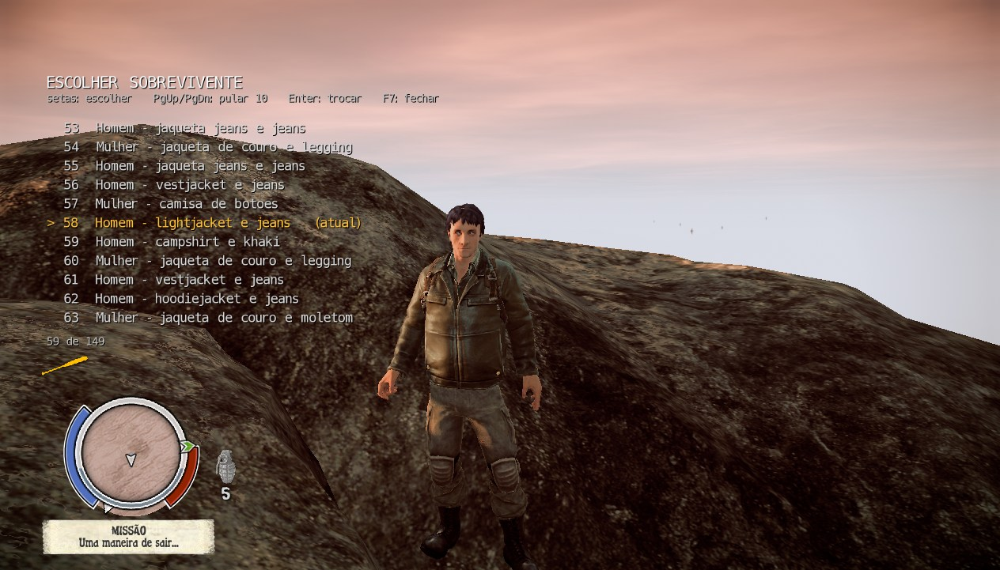
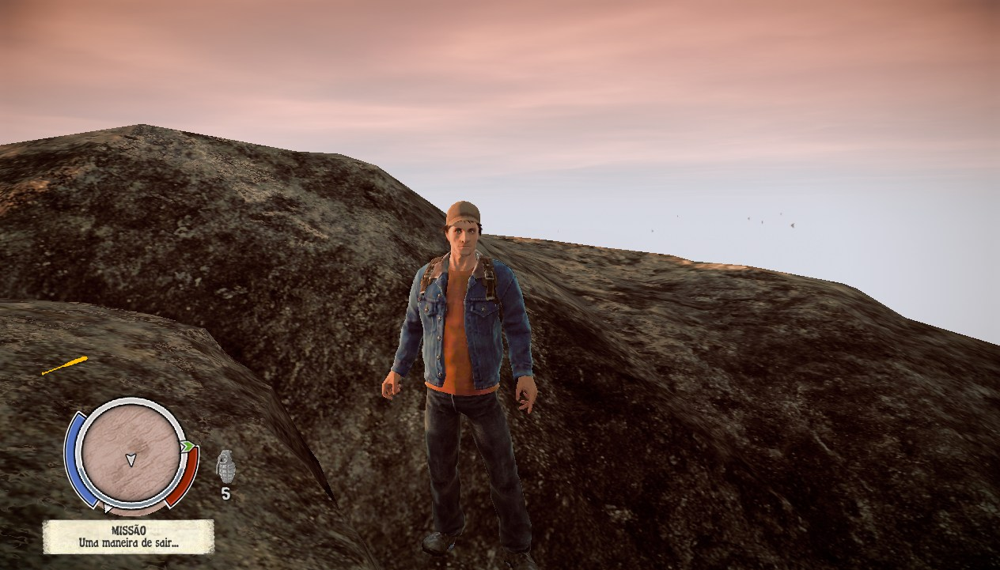
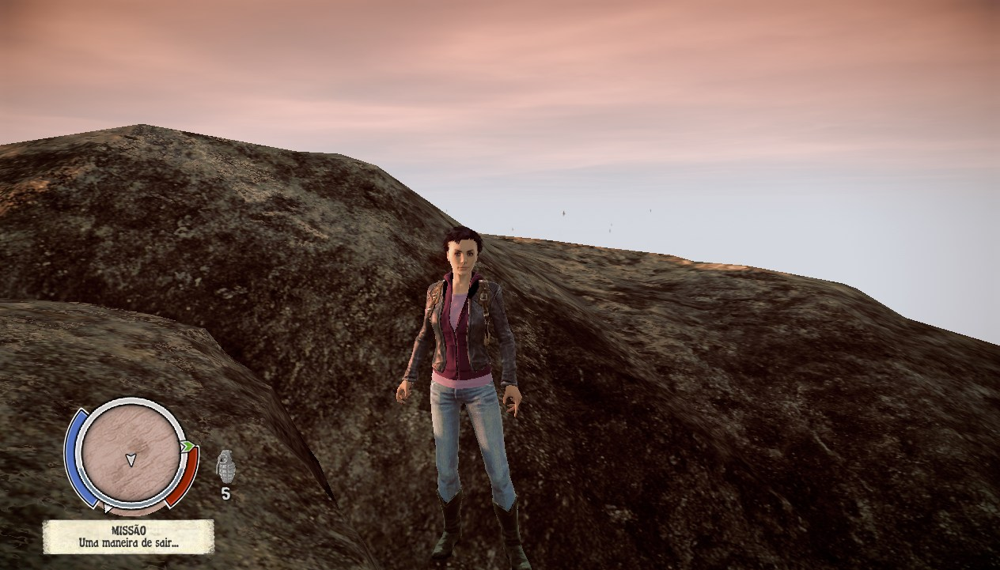

<div align="center">

# 🧟 State of Decay: Year-One — Co-op Mod

**Multiplayer cooperativo para o State of Decay: Year-One Survival Edition (PC/Steam)**

Jogue o modo **Breakdown** junto com um amigo: dois sobreviventes no mesmo mundo.


</div>

---

## 📌 Sobre

O State of Decay original é single-player. Este mod adiciona uma camada de rede ao jogo por meio de uma DLL própria (`dinput8.dll`), sem alterar nenhum arquivo original. Dois jogadores jogam o mesmo Breakdown: um é o **host**, que cria a partida, e o outro é o **client**, que entra nela.

> ⚠️ **Protótipo jogável.** Já dá para jogar junto, mas ainda há limitações (veja abaixo). Faça backup dos seus saves antes de usar. Só funciona na versão **845221** do jogo na Steam.

## 🎮 Como jogar (resumo)

1. **Instale nos dois PCs:** copie `dinput8.dll`, `SoDCoop.exe` e `sodcoop.ini` para a pasta do jogo (a do `StateOfDecay.exe`).
2. **Configure no SoDCoop.exe:** um escolhe **Criar a partida** (host) e o outro **Entrar na partida do amigo** (client). Pela **Steam** (recomendado, sem abrir porta), cada um põe o SteamID64 do outro; a janela mostra o seu, com botão de copiar. Por **IP direto**, o host pode testar a porta por UPnP.
3. **O host** clica em **Salvar e jogar** e entra no Breakdown em **Continuar**.
4. **O client**, com o host já no mundo, clica em **Salvar e jogar**. No menu, o mod **recebe sozinho o save do host** (com backup do save do client). Espere o aviso **"save do host recebido. Pode clicar em Continuar"** no canto da tela e clique em **Continuar**. O client aparece ao lado do host.

Passo a passo completo, com a configuração à mão e o jogo pela internet: [release/LEIA-ME.md](release/LEIA-ME.md) (português) e [release/README.md](release/README.md) (inglês). Os dois vão no pacote.

## ✅ O que já funciona

- [x] Conexão pela **Steam** (sem abrir porta) ou por **IP direto**, com UPnP para o host abrir a porta sozinho
- [x] Janela **SoDCoop.exe** para configurar e abrir o jogo, em português e inglês
- [x] **Save do host enviado ao client** ao conectar, ainda no menu, com backup do save do client
- [x] Os dois jogadores se veem, com movimento, golpes, pulos, arma na mão, mira, tiro e recarga
- [x] Zumbis do host aparecem para o client, perseguem e atacam os dois
- [x] Golpes, tiros, granadas e Molotov do client ferem e matam os zumbis
- [x] O client não morre de verdade: cai e volta ao lado do host
- [x] Carro: dirigir, ir de passageiro e rodas girando
- [x] Base igual nos dois: armário de suprimentos, recursos e construções (construir, terminar, melhorar, demolir)
- [x] Hora do dia, lugares já vasculhados e itens dados ao outro jogador
- [x] Troca de personagem pelo menu do **F7** (abaixo)
- [x] **2560×1440** no menu de opções, em 16:9

## 🎭 Trocar de personagem (F7)

Cada jogador pode escolher com qual sobrevivente quer jogar, a qualquer momento, sem voltar à base. Assim o host e o amigo não precisam jogar com o mesmo personagem.

- **F7** abre o menu **ESCOLHER SOBREVIVENTE**, com a lista de sobreviventes do jogo (homem ou mulher e a roupa de cada um).
- **Setas** escolhem, **PgUp/PgDn** pulam 10 de uma vez, **Enter** troca e **F7** fecha. O personagem atual aparece marcado como "(atual)".
- **F6** troca direto para o sobrevivente anterior, sem abrir o menu.
- O outro jogador vê a aparência nova no seu personagem.
- As teclas podem ser trocadas no `sodcoop.ini`, seção `[keys]` (`next_member` e `prev_member`).

<div align="center">



*O menu aberto com F7: a lista de sobreviventes, com o atual marcado.*

 

*Dois personagens escolhidos pelo menu, no mesmo lugar do mundo.*

</div>

## 🛠️ Limitações e próximos passos

- [ ] Ações das instalações (fabricar, cozinhar, treinar) sincronizadas: hoje rodam só em quem as começou
- [ ] Comunidade (moral, ferimentos, sobreviventes) igual nos dois: hoje cada PC simula a sua
- [ ] Mudar a base de lugar com os dois jogando (ainda não testado)
- [ ] Teste com duas contas Steam diferentes pela internet

Detalhes técnicos e histórico em [docs/PROGRESSO.md](docs/PROGRESSO.md).

## 🛡️ Antivírus (VirusTotal)

Os arquivos da versão 0.1.0 foram analisados no VirusTotal: **4 de 71 antivírus** marcaram o mod (`dinput8.dll`) e **5 de 70** a janela (`SoDCoop.exe`), todos com alertas automáticos (aprendizado de máquina e reputação), nenhum apontando vírus conhecido. Hashes, links, prints e o motivo dos alertas estão em [docs/VIRUSTOTAL.md](docs/VIRUSTOTAL.md) (em inglês e português).

## 🖥️ Mod à parte: resolução 2560×1440

O menu de opções do jogo não tem **2560×1440** em 16:9: depois de 1920×1080, ele pula direto para 4K. O mod de co-op **já inclui** a correção, e ela também existe como **mod separado**, só com isso, para quem quiser apenas a resolução: [mods/resolution_1440p](mods/resolution_1440p/README.md).

---

## 💚 Apoie o projeto

Este mod é **gratuito** e eu **não cobro nada** por ele.
Se você curtir o projeto e quiser ajudar com **qualquer quantia**, é muito bem-vindo. Toda ajuda me incentiva a continuar desenvolvendo! 🙏

<div align="center">


**PIX — chave aleatória**

```
a0c80cfc-ec1f-4183-9b24-1c29d5a50471
```

</div>

---

## 📁 Estrutura do projeto

| Pasta/arquivo | Conteúdo |
|---|---|
| `src/` | DLL do mod (proxy de `dinput8.dll`, x86): `core/` (log, configuração, relógio, janela), `game/` (motor, jogador local, personagem remoto, hooks por frame), `net/` (protocolo, sessão por UDP ou Steam, UPnP e envio do save), `proxy/` |
| `build.ps1` | Compila `build\dinput8.dll` |
| `launcher/` / `build_launcher.ps1` | SoDCoop.exe: janela para configurar o co-op (host/client, Steam/IP, UPnP) e abrir o jogo |
| `mods/resolution_1440p/` | Mod à parte que põe 2560×1440 no menu de opções (sem o co-op) |
| `install.ps1` | Instala/remove o mod nas cópias de teste |
| `package.ps1` / `release/` | Gera o pacote para jogar (`build\release\sodcoop-<data>.zip`: DLL, SoDCoop.exe, `sodcoop.ini` modelo, LEIA-ME e README em inglês) |
| `launch.ps1` / `tile_windows.ps1` | Abre as duas cópias do jogo lado a lado |
| `analysis/` | Scripts de engenharia reversa (Ghidra) |
| `tools/analysis/` | Scripts de análise dos arquivos do jogo |
| `docs/` | Relatório técnico, endereços do motor, protocolo de rede, ambiente de testes e progresso |

### O que não está no repositório

Arquivos do jogo, o executável desempacotado, o projeto do Ghidra e o código descompilado ficam só na máquina local, porque são propriedade da Undead Labs/Microsoft. As ferramentas de terceiros (Ghidra, JDK, llvm-mingw, Steamless, MinHook) também ficam fora; as versões e os hashes estão em [docs/AMBIENTE_DE_TESTES.md](docs/AMBIENTE_DE_TESTES.md).

---

## ⚖️ Licença e aviso

© 2026 Luassushiman. **Todos os direitos reservados.** É proibido copiar, modificar ou redistribuir este código sem autorização. Veja [LICENSE](LICENSE).

*State of Decay* é marca registrada da Microsoft / Undead Labs. Este é um projeto de fã, independente, sem afiliação com a Microsoft ou a Undead Labs e sem endosso delas. É preciso ter o jogo original para usar o mod.
