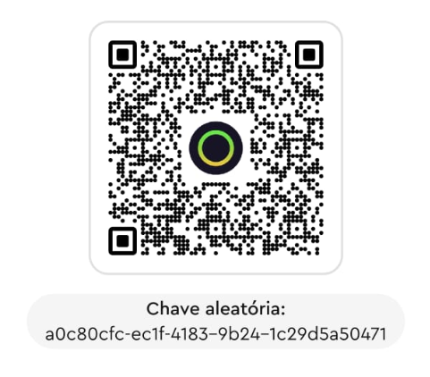

<div align="center">

# 🧟 State of Decay: Year-One — Co-op Mod

**Multiplayer cooperativo para o State of Decay: Year-One Survival Edition (PC/Steam)**

Jogue o modo **Breakdown** junto com um amigo: dois sobreviventes no mesmo mundo.


</div>

---

## 📌 Sobre

O State of Decay original é single-player. Este mod adiciona uma camada de rede ao jogo por meio de uma DLL própria, sem alterar os arquivos originais. Cada jogador vê o outro dentro do mundo, com movimento e animação sincronizados.

> ⚠️ **Projeto em desenvolvimento.** Ainda é um protótipo: por enquanto são sincronizados os jogadores (movimento, golpes, armas e mira) e a posição dos zumbis. Dano, inventário e veículos ainda não.

## ✅ O que já funciona

- [x] Duas instâncias do jogo abertas ao mesmo tempo, no modo Breakdown
- [x] Conexão host ↔ cliente pela rede (UDP)
- [x] Cliente entra na sessão do host
- [x] Posição e rotação dos jogadores sincronizadas (20 atualizações/s, interpoladas)
- [x] O outro jogador aparece no seu mundo como personagem animado (parado, andando, correndo, sprint)
- [x] Golpes, pulos e quedas do outro jogador aparecem no personagem dele (ainda sem dano)
- [x] A arma que o outro jogador está usando aparece na mão dele
- [x] Mira, tiro e recarga do outro jogador aparecem no personagem dele
- [x] Zumbis do host aparecem no mundo do cliente
- [x] Golpes e tiros do cliente ferem e matam os zumbis do host

## 🛠️ Próximos passos

- [ ] Dano dos golpes
- [x] Zumbis do host perseguem e golpeiam o jogador do cliente
- [x] Cliente carrega o mesmo save do host e nasce ao lado dele
- [ ] Mundo do host sincronizado ao vivo (itens, carros, base, comunidade, hora)
- [ ] Inventário e itens
- [ ] Veículos
- [ ] Conexão pela internet (Steam), sem precisar abrir portas

Detalhes técnicos e histórico em [docs/PROGRESSO.md](docs/PROGRESSO.md).

## 🛡️ Antivírus (VirusTotal)

Os arquivos do pacote de 04/11/2026 foram analisados no VirusTotal: **4 de cerca de 70 antivírus** marcaram cada um, todos com alertas automáticos (aprendizado de máquina e reputação), nenhum apontando vírus conhecido. Hashes, links, prints e o motivo dos alertas estão em [docs/VIRUSTOTAL.md](docs/VIRUSTOTAL.md) (em inglês e português).

## 🖥️ Mod à parte: resolução 2560×1440

O menu de opções do jogo não tem **2560×1440** em 16:9: depois de 1920×1080, ele pula direto para 4K. O mod de co-op **já inclui** a correção, e ela também existe como **mod separado**, só com isso, para quem quiser apenas a resolução: [mods/resolution_1440p](mods/resolution_1440p/README.md).

---

## 💚 Apoie o projeto

Este mod é **gratuito** e eu **não cobro nada** por ele.
Se você curtir o projeto e quiser ajudar com **qualquer quantia**, é muito bem-vindo. Toda ajuda me incentiva a continuar desenvolvendo! 🙏

<div align="center">



**PIX — chave aleatória**

```
a0c80cfc-ec1f-4183-9b24-1c29d5a50471
```

</div>

---

## 📁 Estrutura do projeto

| Pasta/arquivo | Conteúdo |
|---|---|
| `src/` | DLL do mod (proxy de `dinput8.dll`, x86): `core/` (log, configuração, relógio, janela), `game/` (motor, jogador local, personagem remoto, hooks por frame), `net/` (protocolo UDP e sessão), `proxy/` |
| `build.ps1` | Compila `build\dinput8.dll` |
| `launcher/` / `build_launcher.ps1` | SoDCoop.exe: janela para configurar o co-op (host/client, Steam/IP, UPnP) e abrir o jogo |
| `mods/resolution_1440p/` | Mod à parte que põe 2560×1440 no menu de opções (sem o co-op) |
| `install.ps1` | Instala/remove o mod nas cópias de teste |
| `package.ps1` / `release/` | Gera o pacote para jogar (`build\release\sodcoop-<data>.zip`: DLL, `sodcoop.ini` modelo e LEIA-ME) |
| `launch.ps1` / `tile_windows.ps1` | Abre as duas cópias do jogo lado a lado |
| `analysis/` | Scripts de engenharia reversa (Ghidra) |
| `tools/analysis/` | Scripts de análise dos arquivos do jogo |
| `docs/` | Relatório técnico, endereços do motor, protocolo de rede, ambiente de testes e progresso |

### O que não está no repositório

Arquivos do jogo, o executável desempacotado, o projeto do Ghidra e o código descompilado ficam só na máquina local, porque são propriedade da Undead Labs/Microsoft. As ferramentas de terceiros (Ghidra, JDK, llvm-mingw, Steamless, MinHook) também ficam fora; as versões e os hashes estão em [docs/AMBIENTE_DE_TESTES.md](docs/AMBIENTE_DE_TESTES.md).

---

## ⚖️ Licença e aviso

© 2026 Luassushiman. **Todos os direitos reservados.** É proibido copiar, modificar ou redistribuir este código sem autorização. Veja [LICENSE](LICENSE).

*State of Decay* é marca registrada da Microsoft / Undead Labs. Este é um projeto de fã, independente, sem afiliação com a Microsoft ou a Undead Labs e sem endosso delas. É preciso ter o jogo original para usar o mod.
