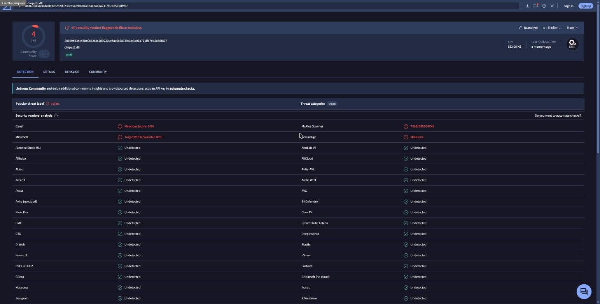
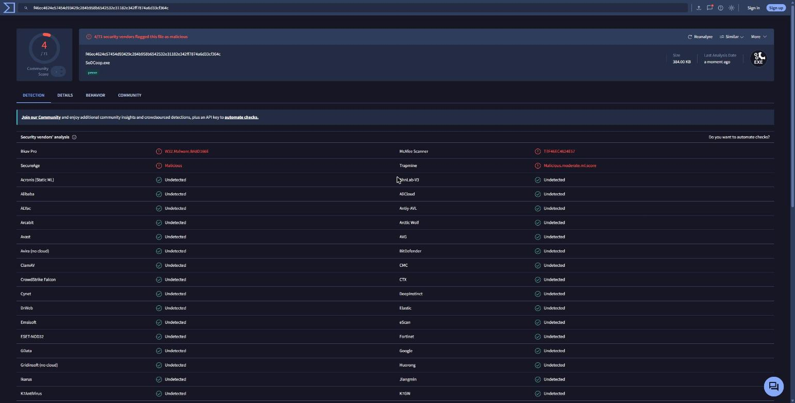

# VirusTotal: antivirus scan results

[English](#english) · [Português](#português)

## English

I scanned the files of the **2026-11-04** package (`sodcoop-20261104.zip`) on VirusTotal. The result **isn't zero**: each file was flagged by **4 of about 70 antivirus engines**. I'm publishing it as it is, with the links and screenshots, so you can check it yourself and decide.

### Results

| File | SHA-256 | Flagged by | VirusTotal |
|---|---|---|---|
| `dinput8.dll` (the mod) | `881695d34c46bc0c32c2c2d9230ce5ae9c68749dae3a07a711ffc7ed5a5df897` | 4 of 70: Microsoft (`Trojan:Win32/Wacatac.B!ml`), McAfee Scanner (`Ti!881695D34C46`), Cynet (`Malicious (score: 100)`), SecureAge (`Malicious`) | [open report](https://www.virustotal.com/gui/file/881695d34c46bc0c32c2c2d9230ce5ae9c68749dae3a07a711ffc7ed5a5df897) |
| `SoDCoop.exe` (the setup window) | `f46ec4624e57454d93429c284b958b6542532e31182e342ff7874a6d33cf364c` | 4 of 71: Bkav Pro (`W32.Malware…`), McAfee Scanner (`Ti!F46EC4624E57`), SecureAge (`Malicious`), Trapmine (`Malicious.moderate.ml.score`) | [open report](https://www.virustotal.com/gui/file/f46ec4624e57454d93429c284b958b6542532e31182e342ff7874a6d33cf364c) |
| `sodcoop-20261104.zip` (the package) | `fe742b7187f17b1c2a6b3f3ad4f7ce1294b88ecf46143de233cbd4d7ff8d06fe` | not uploaded; it holds the two files above plus text files | — |

To check that your copy is the same file, open PowerShell in the folder and compare the output with the table:

```powershell
Get-FileHash dinput8.dll, SoDCoop.exe -Algorithm SHA256
```

A newer build has different hashes. This page only covers the files above.

### Screenshots

**dinput8.dll: 4/70**



**SoDCoop.exe: 4/71**



### Why these alerts show up

None of the alerts names a known virus. They are **automatic guesses**: `!ml` and `ml.score` mean "machine learning", McAfee's `Ti!<hash>` is a reputation score for that exact file, and Cynet's and SecureAge's "Malicious" don't name any family. The big engines that look for known threats (BitDefender, ESET, Avast, AVG, CrowdStrike, Fortinet, GData, ClamAV and others) found nothing.

The mod does exactly the things these detectors are trained to distrust, because that's how co-op is added to a game that never had it:

- **`dinput8.dll` has the name of a Windows file.** The game loads it from its own folder instead of the real one. That's how the mod gets inside the game without changing any game file. Malware uses the same trick (DLL hijacking).
- **It changes the game's code in memory while it runs.** It hooks game functions (with the MinHook library) and reads and writes the game's memory to sync players, zombies and the base.
- **It connects to the network.** It sends and receives game data through Steam or UDP. On the host, in direct IP mode, it asks the router to open a port (UPnP).
- **`SoDCoop.exe` reads the registry and starts the game.** It reads which Steam account is logged in, to show your SteamID64, writes `sodcoop.ini` and starts the game through `steam://`.
- **The files have no digital signature and are brand new.** A signing certificate costs money, and almost nobody has downloaded these files yet, so they have no reputation. Reputation-based engines distrust any new file like that.

What the mod **doesn't** do: it doesn't change any file of the game or of Windows, it doesn't run anything in the background after you close the game, and it only writes to the game folder (`sodcoop.ini`, the log `sodcoop_default.log`, and crash dumps `sodcoop_*.dmp` if the game crashes).

### If Windows Defender deletes the file

Microsoft is one of the four, so on some PCs Windows Defender may quarantine `dinput8.dll` and the mod won't load. If that happens and you trust these files, after comparing the hashes above:

1. Open **Windows Security → Virus & threat protection → Protection history** and restore the file.
2. Optionally, add an exclusion for the file itself (`dinput8.dll` in the game folder) under **Manage settings → Exclusions**.

The false-positive report to Microsoft still has to be sent. Until it's reviewed, the alert may stay.

### Source

The mod is built from this repository's source code (`src/`, `launcher/`) with `build.ps1`, `build_launcher.ps1` and `package.ps1`.

---

## Português

Analisei no VirusTotal os arquivos do pacote de **04/11/2026** (`sodcoop-20261104.zip`). O resultado **não foi zero**: cada arquivo foi marcado por **4 de cerca de 70 antivírus**. Publico como está, com os links e os prints, para você conferir e decidir.

### Resultado

| Arquivo | SHA-256 | Marcado por | VirusTotal |
|---|---|---|---|
| `dinput8.dll` (o mod) | `881695d34c46bc0c32c2c2d9230ce5ae9c68749dae3a07a711ffc7ed5a5df897` | 4 de 70: Microsoft (`Trojan:Win32/Wacatac.B!ml`), McAfee Scanner (`Ti!881695D34C46`), Cynet (`Malicious (score: 100)`), SecureAge (`Malicious`) | [abrir relatório](https://www.virustotal.com/gui/file/881695d34c46bc0c32c2c2d9230ce5ae9c68749dae3a07a711ffc7ed5a5df897) |
| `SoDCoop.exe` (a janela de configuração) | `f46ec4624e57454d93429c284b958b6542532e31182e342ff7874a6d33cf364c` | 4 de 71: Bkav Pro (`W32.Malware…`), McAfee Scanner (`Ti!F46EC4624E57`), SecureAge (`Malicious`), Trapmine (`Malicious.moderate.ml.score`) | [abrir relatório](https://www.virustotal.com/gui/file/f46ec4624e57454d93429c284b958b6542532e31182e342ff7874a6d33cf364c) |
| `sodcoop-20261104.zip` (o pacote) | `fe742b7187f17b1c2a6b3f3ad4f7ce1294b88ecf46143de233cbd4d7ff8d06fe` | não enviado; contém os dois arquivos acima e arquivos de texto | — |

Para conferir se a sua cópia é o mesmo arquivo, abra o PowerShell na pasta e compare com a tabela:

```powershell
Get-FileHash dinput8.dll, SoDCoop.exe -Algorithm SHA256
```

Uma versão mais nova tem outros hashes. Esta página vale só para os arquivos acima. Os prints estão na seção em inglês.

### Por que os alertas aparecem

Nenhum alerta aponta um vírus conhecido. São **palpites automáticos**: `!ml` e `ml.score` querem dizer "aprendizado de máquina", o `Ti!<hash>` da McAfee é uma nota de reputação daquele arquivo, e o "Malicious" da Cynet e da SecureAge não cita nenhuma família de vírus. Os antivírus grandes que procuram ameaças conhecidas (BitDefender, ESET, Avast, AVG, CrowdStrike, Fortinet, GData, ClamAV e outros) não acharam nada.

O mod faz justamente o que esses detectores aprendem a desconfiar, porque é assim que se põe co-op num jogo que nunca teve:

- **O `dinput8.dll` tem o nome de um arquivo do Windows.** O jogo carrega o da própria pasta no lugar do verdadeiro, e é assim que o mod entra no jogo sem alterar nenhum arquivo dele. Vírus usam o mesmo truque (DLL hijacking).
- **Ele muda o código do jogo na memória enquanto o jogo roda.** Intercepta funções do jogo (com a biblioteca MinHook) e lê e escreve na memória do jogo para sincronizar jogadores, zumbis e a base.
- **Ele usa a rede.** Envia e recebe os dados da partida pela Steam ou por UDP. No host, no modo IP direto, pede ao roteador para abrir uma porta (UPnP).
- **O `SoDCoop.exe` lê o registro e abre o jogo.** Lê qual conta da Steam está logada, para mostrar o seu SteamID64, grava o `sodcoop.ini` e abre o jogo pelo `steam://`.
- **Os arquivos não têm assinatura digital e são novos.** O certificado de assinatura é pago, e quase ninguém baixou esses arquivos ainda, então eles não têm reputação. Antivírus que se baseiam em reputação desconfiam de qualquer arquivo novo assim.

O que o mod **não** faz: não altera nenhum arquivo do jogo nem do Windows, não fica rodando depois que você fecha o jogo, e só grava na pasta do jogo (o `sodcoop.ini`, o log `sodcoop_default.log` e, se o jogo travar, os dumps `sodcoop_*.dmp`).

### Se o Windows Defender apagar o arquivo

A Microsoft é um dos quatro, então em alguns PCs o Windows Defender pode pôr o `dinput8.dll` em quarentena, e o mod não carrega. Se acontecer e você confiar nos arquivos, depois de comparar os hashes acima:

1. Abra **Segurança do Windows → Proteção contra vírus e ameaças → Histórico de proteção** e restaure o arquivo.
2. Se quiser, adicione uma exclusão só para o arquivo (`dinput8.dll` na pasta do jogo) em **Gerenciar configurações → Exclusões**.

O aviso de falso positivo para a Microsoft ainda precisa ser enviado. Até ela analisar, o alerta pode continuar.

### Código

O mod é compilado a partir do código deste repositório (`src/`, `launcher/`) com `build.ps1`, `build_launcher.ps1` e `package.ps1`.
